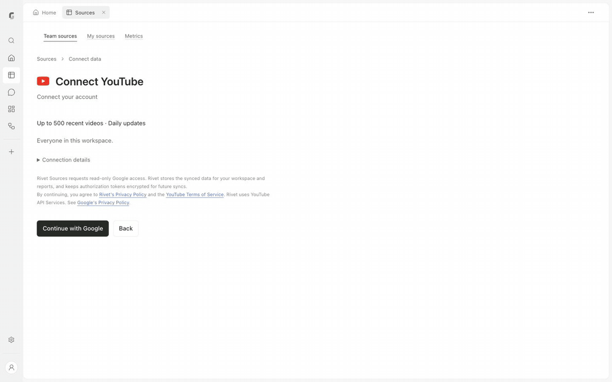

# Rivet

Rivet is a desktop workspace for asking questions about social and business data,
checking the calculations, and keeping reports with their source records.

**Open-source social and data analyst.** Apache-2.0 desktop source alpha.
Ask questions with a local model, view charts and tables, and inspect the original
rows behind a number. Self-improving workflows are a future direction, not an
implemented capability. A signed, notarized Mac download is not available yet.

[Get started](#get-started) | [Capabilities](#current-capabilities) |
[Source layout](#source-layout) | [Contributing](CONTRIBUTING.md) |
[Security](SECURITY.md) | [License](LICENSE) | [Changelog](CHANGELOG.md) |
[Source boundary](SOURCE_BOUNDARY.md)

[Star Rivet on GitHub](https://github.com/rivetfields-research/rivet) |
[Contribute to Rivet](#your-first-contribution) |
[Report an issue](https://github.com/rivetfields-research/rivet/issues/new?template=bug_report.md)

[](docs/media/rivet-workflow.mp4)

[Watch the full-quality MP4](docs/media/rivet-workflow.mp4). The GIF preview runs at 2x.

Edited hosted-UI capture using a 240-row QA/sample social CSV, not verified
live-account performance. It does not demonstrate completed OAuth, native-desktop
parity or email delivery. The existing schedule is shown without changing it.

## Current Capabilities

The desktop alpha can:

- Import CSVs and supported documents into a local workspace.
- Calculate results, inspect contributing rows, and retain saved reports and
  source snapshots with chart and table views.
- Browse imported sources and saved work without selecting a model.
- Send bounded requests to a selected loopback OpenAI-compatible model server.
  Invalid, refused or truncated responses do not complete an action.

The desktop shell disables cloud connections, organization administration,
billing and outgoing email. Shared source still includes these implementations
and screens. Automatic self-improvement is not implemented.

This is the curated baseline from harness commit
`1574d8b7533b0f63e0b882c36b346e03ffea913d`, with documented source-review changes.
Selected parent working-tree changes add the shared Connect data catalog, a
local model-settings action and the report-runtime fixes from the tested Mac
alpha. Their captured file hashes are recorded separately
from the pinned baseline in `SOURCE_MANIFEST.json`. Broader cloud/local parity and
OAuth architecture work remain outside this repository.

In the desktop UI, use **Sources > Connect source** to open **Connect data**, or
**Upload file** for a CSV or document. Its seven-platform catalog names Instagram,
Facebook Pages, LinkedIn, YouTube, Mailchimp, Google Analytics and X. Account
connections remain unavailable; displaying a platform does not authorize it.
When a model is missing or unavailable, Home offers **Choose model** or **Model
settings** through a restricted workspace bridge. Opening settings preserves the
current workspace; applying a choice restarts its backend.

The report runtime requests structured JSON from the local model, offers bounded
recovery for an incorrect ID of an already-read selected dataset, and rejects
calculations that omit or shorten a recognized explicit publication window.
Permissions, strict parsing, cancellation, and action/time limits remain in place.
The date guard recognizes one unambiguous English month-name range; it is not a
general natural-language date parser.

The corresponding Mac alpha was tested with Ollama and `qwen3.5:4b`: a
48-row fictional CSV produced a 12-week report totaling 1,551 recorded likes.
The report survived quitting and reopening, and clicking a weekly total opened
its four original rows. Bar and Line rendering were confirmed by the tester.
The first real-model acceptance used a parent working-tree build. The imported
runtime files match it exactly. A subsequent clean-source package also launched,
loaded the existing model choice and recovered that report. Automated tests here
use synthetic model responses. Neither this evidence nor the source release
establishes a fresh-device installation or compatibility with every model.

## Requirements

| Area | Requirement or current limit |
| --- | --- |
| Source checks | Node **24.19.0**, pinned in `.nvmrc`, and npm |
| Native target | Apple-silicon macOS; Windows, Linux and Intel Mac desktop builds are not verified |
| AI answers | A separately installed local OpenAI-compatible server with `/v1/models` and `/v1/chat/completions` |
| Model storage | Weights are not bundled; disk space, memory and model compatibility depend on the selected model |
| Credentials | The desktop setup accepts loopback addresses and a model ID, not remote provider API keys |

An example local endpoint is `http://127.0.0.1:11434/v1`. A model appearing in a
server's list does not prove compatibility, report quality or where inference
actually occurs. The source checks use synthetic responses, not a real model.

## Get Started

For source development and checks:

```sh
git clone https://github.com/rivetfields-research/rivet.git
cd rivet
# Select Node 24.19.0 with your usual version manager.
npm ci --ignore-scripts --no-audit --no-fund
npm run check
```

The locked root install does not download Electron or model weights. Install
scripts are disabled. `npm run check` verifies source provenance and boundaries,
type-checks the exported TypeScript, runs selected existing tests plus repository
guards, and builds the renderer with Vite.

| Command | What it checks |
| --- | --- |
| `npm run check:source` | Inventory, recorded hashes, package locks, approved Apache-2.0 text/metadata and selected credential patterns |
| `npm run typecheck` | Exported TypeScript and React types |
| `npm test` | Desktop, API, parser, recovery, credential, calculation, renderer and repository guard tests |
| `npm run build` | Renderer compilation into `dist/web/` |
| `npm run audit:staged` | Exact index paths and bytes against the reviewed manifest before a commit |

The check runner clears inherited cloud credentials and Node hooks. Tests use
disposable loopback servers and synthetic inputs, with external and standard
model-server endpoints blocked. Temporary homes, data and caches stay under
`.local-checks/`. That directory, `node_modules/` and `dist/` are ignored and must
never be committed. Checks do not open Electron or a browser or run inference.

### Build A Local Mac Alpha

On native Apple-silicon macOS with Node 24.19.0, finish the checks above, then use
a new output directory outside every Git checkout:

```sh
npm run desktop:package -- --output "$HOME/Downloads/Rivet-source-test" --confirm-code-stable
npm run desktop:verify -- "$HOME/Downloads/Rivet-source-test"
```

Packaging downloads the pinned official Node and Electron runtimes and locked
npm dependencies. It checks runtime archives, rejects source changes during the
build, and produces an app, DMG, manifest and checksums. Verification checks the
entire app inventory and DMG against that manifest; it is an integrity check,
not a signature or an independent authorship guarantee.

Quit other Rivet Alpha copies before opening the new app. The verified launch
command is `npm run desktop:launch -- "$HOME/Downloads/Rivet-source-test"`.
It uses normal macOS launching and does not bypass Gatekeeper. These are local,
unsigned, unnotarized test artifacts, not a public installer. Back up existing app
data first. Neither packaging nor verification runs inference or validates a
fresh-device installation.

Do not launch `apps/server/src/index.ts` directly as a desktop substitute:
ordinary local mode can load `.env` and has different connector defaults.

## Source Layout

```text
apps/desktop/          Electron shell, local model setup and launch isolation
apps/server/src/      Loopback API and required shared server modules
apps/web/src/         React workspace and retained shared screens
packages/core/src/    Runtime, tools, source permissions and durable state
packages/data-layer/  CSV ingestion, calculations and source evidence
packages/presentation/ Reports, charts and exports
scripts/              Local packager source and desktop regression tests
tools/                Export provenance, isolated checks and index audit
.github/              Issue/PR templates and checks-only CI
```

`SOURCE_MANIFEST.json` records the original tracked blobs and hashes, local
review changes and new support files. The initial commit starts fresh history;
no original commits, deployment/customer records, external fixtures, secrets,
private data or unapproved public artwork were imported. Retained cloud code and
explicitly fictional in-code examples are detailed in [SOURCE_BOUNDARY.md](SOURCE_BOUNDARY.md).
Existing [third-party notices](THIRD_PARTY_NOTICES.txt) are preserved verbatim.

## Data And Safety

The existing desktop shell uses
`~/Library/Application Support/Rivet Alpha/` for local app data. Replacing or
quitting an app does not remove that data. Back it up before testing a newer
native build; rollback and migration compatibility are not promised here.
Contributor checks use disposable directories instead of this app data.

The shell restricts renderer Node access and protects its loopback backend with
a per-launch credential. These mechanisms and unit tests are not a complete
security assessment. Never place credentials, real customer records, screenshots
of private workspaces or application data in an issue, PR or source tree.

## Contributing And Releases

### Your First Contribution

New to Rivet or open source? A focused documentation correction or a reproducible
bug report is a useful place to start. You do not need a local model, provider
account or desktop build to run the source checks.

1. Browse [open issues](https://github.com/rivetfields-research/rivet/issues),
   including any labeled
   [good first issue](https://github.com/rivetfields-research/rivet/issues?q=is%3Aissue%20is%3Aopen%20label%3A%22good%20first%20issue%22).
   Comment on one you want to work on so maintainers can confirm its scope.
   If you found an unclear setup step or a bug, open an issue with the source
   revision, expected behavior and a minimal example using invented data.
2. Follow [Fork And Set Up](CONTRIBUTING.md#fork-and-set-up) to create your fork
   and a branch, install the locked dependencies, and run `npm run check`.
3. Make one small change. For example, clarify a setup instruction you verified
   locally, or add a synthetic reproduction to an existing test. Review the
   explicit paths and [record provenance](CONTRIBUTING.md#validate-and-record-provenance),
   then run the full check and staged audit, including for documentation changes.
4. Follow [Open Your First PR](CONTRIBUTING.md#open-your-first-pr) to commit to
   your fork and open a pull request against `main`. Link the issue, explain the
   change, and include check results and anything you could not validate.

Use [private security reporting](SECURITY.md) for suspected vulnerabilities.
Keep examples synthetic and leave private workspace captures and app data out
of issues and pull requests.

### Release Boundaries

Keep proposals focused and linked to an issue. Follow [CONTRIBUTING.md](CONTRIBUTING.md)
for local checks and provenance updates, and [SECURITY.md](SECURITY.md) for private
reporting. CI runs source checks, tests and a renderer build with no deployment,
publication, signing or live-provider credentials.

Rivet is licensed under [Apache-2.0](LICENSE). Copyright 2026 Rivetfields
contributors. See [NOTICE](NOTICE) and [third-party notices](THIRD_PARTY_NOTICES.txt)
for attribution; third-party components retain their own licenses. Both npm
package roots remain `private: true` to prevent accidental registry publication,
not to restrict access to this source.

This first release contains source only, including GitHub's source archives.
Fresh-device installation, wider model compatibility, desktop connectors,
signing/notarization, updates, complete bundled-runtime notices and further
security review remain work for a desktop-binary release. No downloadable app is
advertised here. Cloud/live email services are not configured by this repository.
